# Site Map & Architecture Diagram - Transaction Categorizer

## Executive Summary
This document provides a comprehensive architectural overview of the Transaction Categorizer application, including module structure, component hierarchy, data flow diagrams, service interactions, and routing architecture—all visualized with Mermaid diagrams.

---

## 1. Module Structure Diagram

### 1.1 Application Module Hierarchy

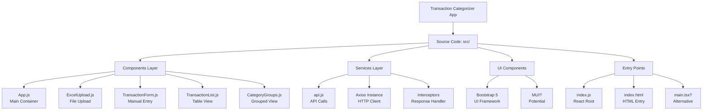

---

### 1.2 Directory Structure with Dependencies

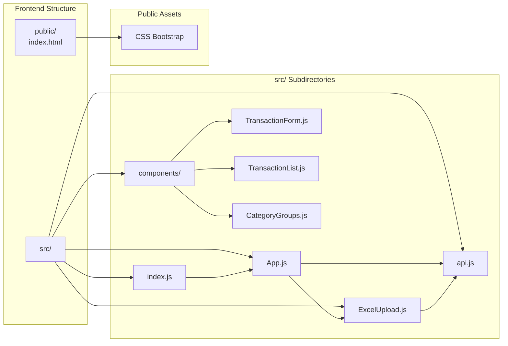

---

## 2. Component Hierarchy Diagram

### 2.1 Component Tree Structure

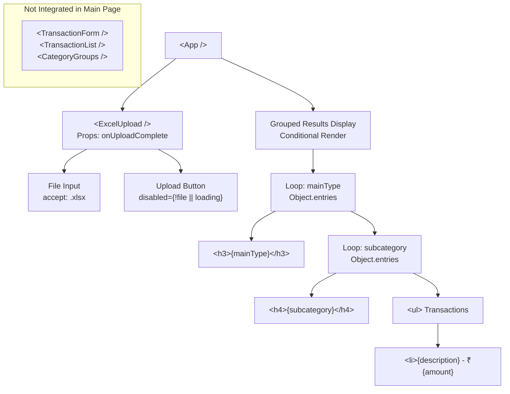

---

### 2.2 Component Composition Details

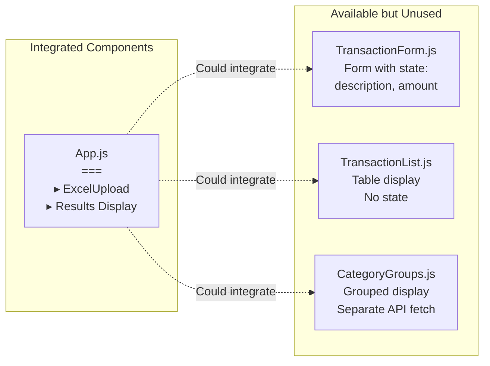

---

## 3. Data Flow Diagram (Frontend to Backend)

### 3.1 Complete Data Flow for Excel Upload

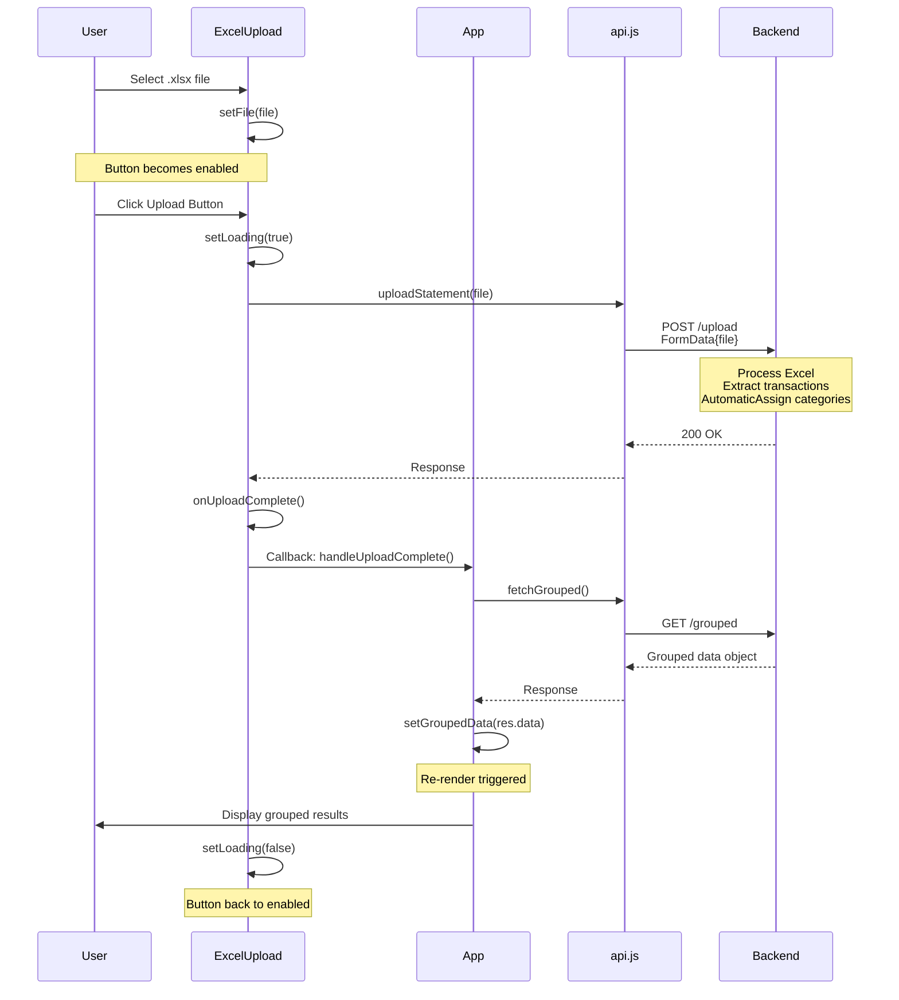

---

### 3.2 Data Flow for Transaction Submission

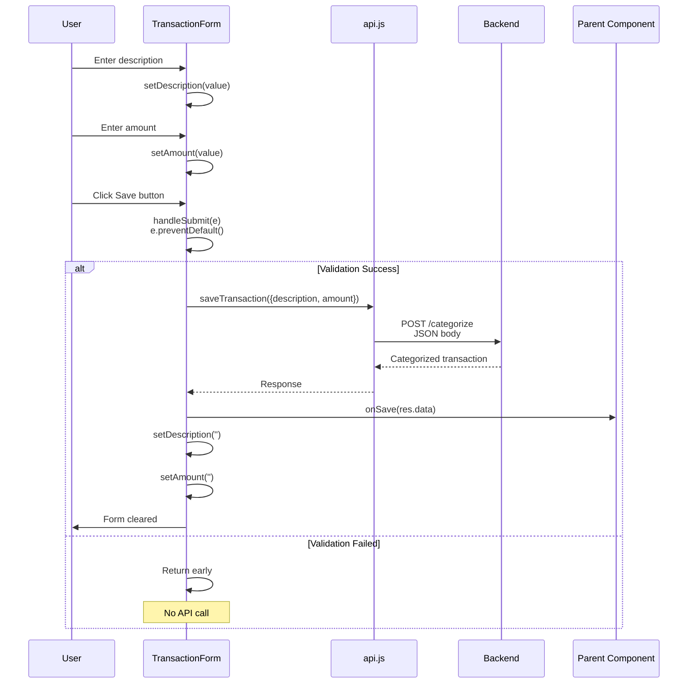

---

### 3.3 Data Structures Flow

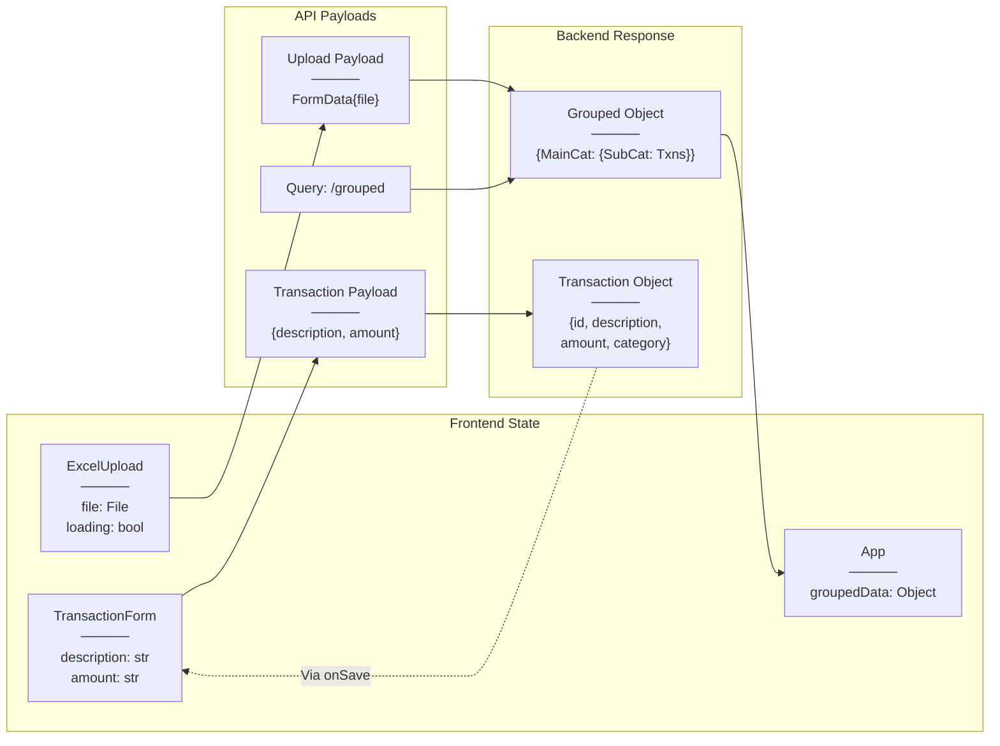

---

## 4. Service Interaction Diagram

### 4.1 API Service Layer

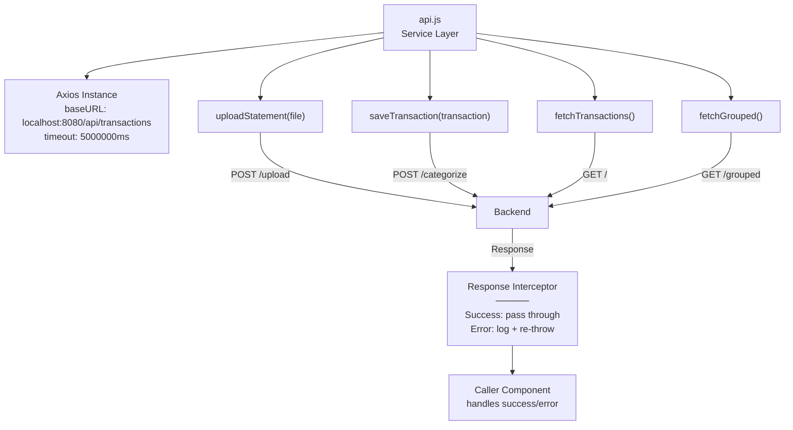

---

### 4.2 Component to API Service Flow

```mermaid
graph TB
    subgraph "Components"
        A["ExcelUpload"]
        B["TransactionForm"]
        C["App"]
        D["CategoryGroups"]
    end
    
    subgraph "API Service"
        API["api.js<br/>────────<br/>uploadStatement()<br/>saveTransaction()<br/>fetchTransactions()<br/>fetchGrouped()"]
    end
    
    subgraph "Backend Endpoints"
        E1["POST /upload"]
        E2["POST /categorize"]
        E3["GET /"]
        E4["GET /grouped"]
    end
    
    A -->|uploadStatement()| API
    B -->|saveTransaction()| API
    C -->|fetchGrouped()| API
    D -->|fetchGrouped()| API
    
    API --> E1
    API --> E2
    API --> E3
    API --> E4
    
    E1 -->|Response| A
    E2 -->|Response| B
    E3 --> API
    E4 -->|Response| C
    E4 -->|Response| D
    
    Note over C,D: Duplicate API calls!<br/>Same endpoint called twice
```

---

## 5. State Management Architecture

### 5.1 State Flow Architecture

```mermaid
graph TD
    A["Component State<br/>(No Redux/Context)"]
    
    A --> B["App Component<br/>─────<br/>groupedData"]
    A --> C["ExcelUpload Component<br/>─────<br/>file<br/>loading"]
    A --> D["TransactionForm Component<br/>─────<br/>description<br/>amount"]
    A --> E["CategoryGroups Component<br/>─────<br/>grouped"]
    
    B -->|Callback| C
    C -->|onUploadComplete| B
    
    D -->|onSave| Parent["Parent Component<br/>(not shown)"]
    E -->|Isolated| E
    
    Note over A: Props drilling via callbacks<br/>No global state
```

---

### 5.2 State Persistence Chart

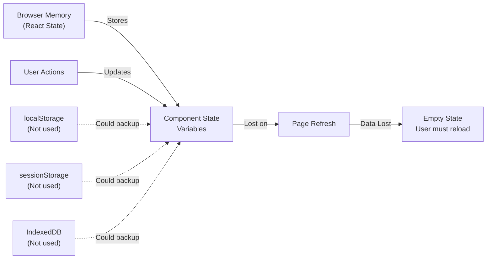

---

## 6. Routing Architecture Diagram

### 6.1 Routing Structure

```mermaid
graph TD
    A["index.html<br/>public/index.html"]
    
    B["App.js<br/>(No React Router)"]
    
    C["Single Page<br/>─────<br/>▸ ExcelUpload<br/>▸ Grouped Results"]
    
    A -->|Loads| B
    B -->|Renders| C
    
    D["Potential Routes<br/>(Not Implemented)"]
    D1["/ - Dashboard"]
    D2["/upload - Upload Page"]
    D3["/transactions - Transactions List"]
    D4["/categories - Category View"]
    
    D --> D1
    D --> D2
    D --> D3
    D --> D4
    
    Note over B,D: SPA with no routing<br/>All on single page
```

---

### 6.2 Navigation Flow

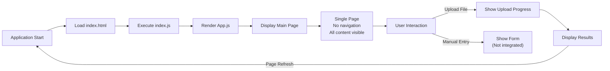

---

## 7. Component Communication Diagram

### 7.1 Props & Callbacks Flow

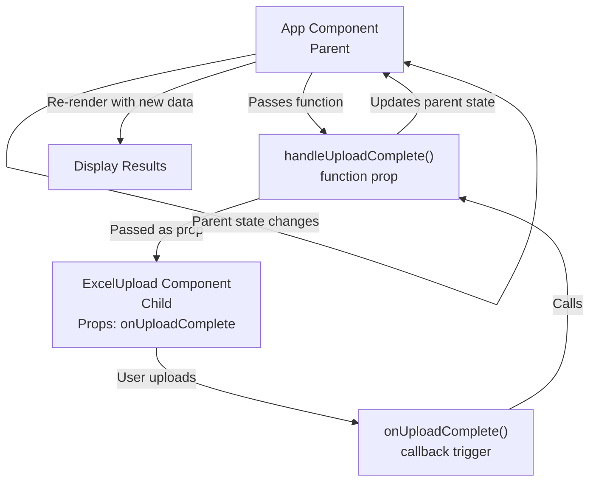

---

### 7.2 Data Sharing Pattern

```mermaid
graph TB
    subgraph "Data Shared"
        A["App.js<br/>groupedData state"]
    end
    
    subgraph "Consumers"
        B["Inline rendering<br/>in App.js"]
        C["TransactionList<br/>(prop: transactions)"]
        D["CategoryGroups<br/>(independent fetch)"]
    end
    
    A -->|Direct inline render| B
    A -.->|Could pass| C
    D -->|Fetches separately<br/>DUPLICATE CALL| A
    
    Note over D: Inefficient<br/>Should use App's state
```

---

## 8. Error Handling Flow

### 8.1 Error Handling Architecture

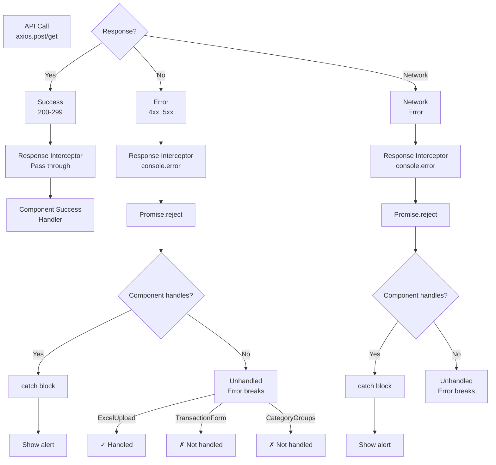

---

## 9. Complete System Architecture

### 9.1 High-Level System Diagram

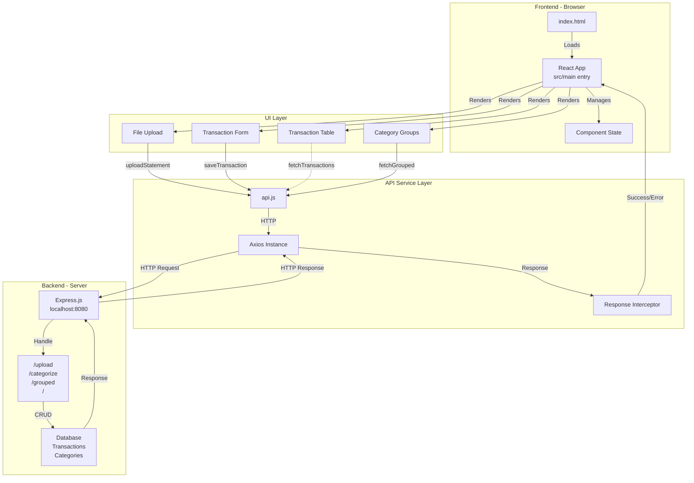

---

### 9.2 Technology Stack Pyramid

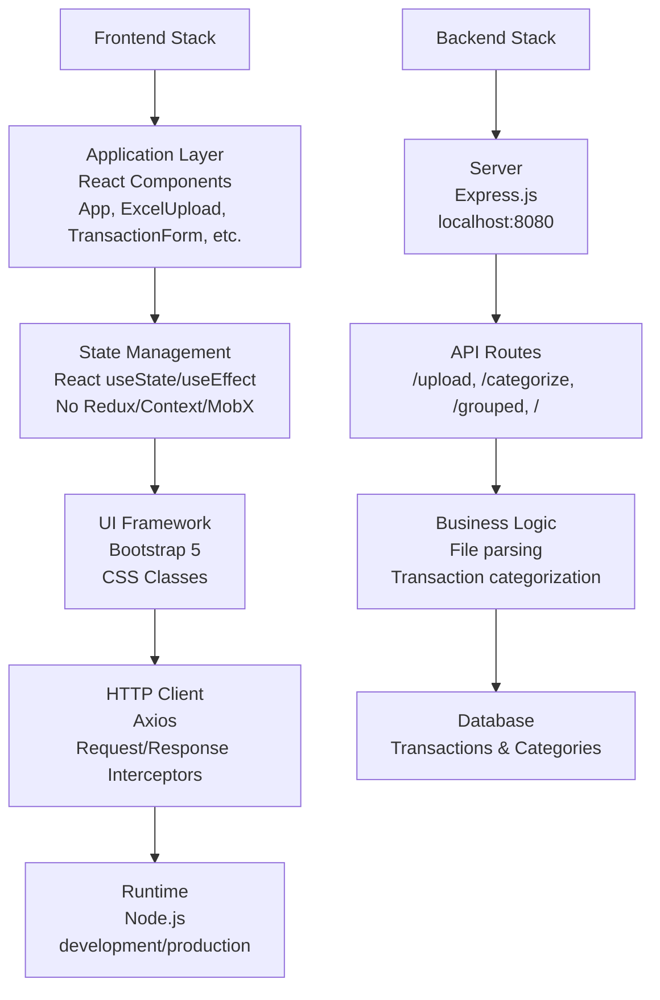

---

## 10. Dependency Graph

### 10.1 File Dependencies

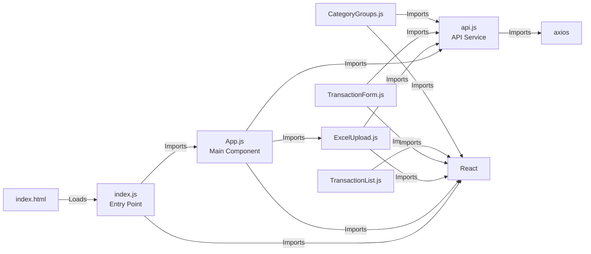

---

## 11. Data Volume & Scaling

### 11.1 Data Growth Pattern

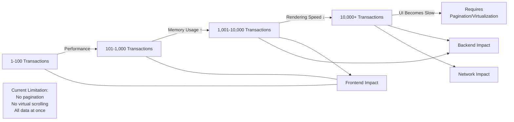

---

## 12. Proposed Architecture Improvements

### 12.1 Recommended Enhancements

```mermaid
graph TD
    A["Current Architecture"]
    
    B["Recommendations"]
    
    B1["Add Context API<br/>for shared state"]
    B2["Implement React Router<br/>for navigation"]
    B3["Add Redux Toolkit<br/>for complex state"]
    B4["Pagination for<br/>large datasets"]
    B5["Error Boundary<br/>component"]
    B6["localStorage<br/>persistence"]
    
    A --> B
    B --> B1
    B --> B2
    B --> B3
    B --> B4
    B --> B5
    B --> B6
    
    C["Benefits"]
    C1["Reduced code duplication"]
    C2["Better navigation"]
    C3["Scalable state"]
    C4["Performance"]
    C5["Better error handling"]
    C6["Data persistence"]
    
    B1 --> C1
    B2 --> C2
    B3 --> C3
    B4 --> C4
    B5 --> C5
    B6 --> C6
```

---

## Summary

### Architecture Quality Metrics

| Aspect | Current | Target | Gap |
|--------|---------|--------|-----|
| Component Organization | ✅ Good | ✅ Good | 0 |
| State Management | ⚠️ Basic | ✅ Intermediate | Medium |
| Routing | ❌ None | ✅ Present | High |
| Error Handling | ⚠️ Inconsistent | ✅ Complete | Medium |
| Performance Optimization | ❌ None | ✅ Implemented | High |
| Code Reusability | ⚠️ Limited | ✅ High | Medium |
| Scalability | ❌ Limited | ✅ Scalable | High |
| Type Safety | ❌ None | ✅ TypeScript | High |

---

## Key Architectural Insights

1. **Simple Single-Page Application**: No routing, all content on one page
2. **Component-Only State**: No global state management (Redux, Context)
3. **Props & Callbacks Pattern**: Basic React pattern for component communication
4. **Duplicate API Calls**: Two components fetch same `/grouped` endpoint
5. **Limited Error Handling**: Inconsistent across components
6. **No Data Persistence**: All state lost on page refresh
7. **Bootstrap 5 UI**: Simple CSS framework, no component library
8. **Axios HTTP Client**: Standard setup with basic interceptors

---

## Files & Modules Reference

```javascript
// Entry Points
public/index.html
src/index.js

// Components (Integrated)
src/App.js
src/ExcelUpload.js

// Components (Available but not integrated)
src/components/TransactionForm.js
src/components/TransactionList.js
src/components/CategoryGroups.js

// Services
src/api.js

// Styling
public/index.html (Bootstrap 5 via CDN)
src/index.css (custom styles)
```

