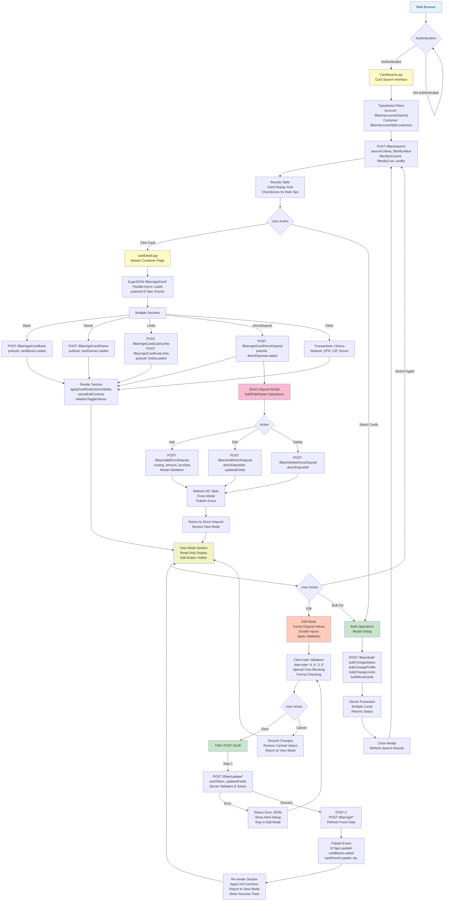

# Site Map and Architecture Diagram: Card Maintenance System

### System Architecture - Mermaid Diagram



---

### System Architecture Overview

#### **1. Entry Point Flow**

| Component | Description |
|-----------|-------------|
| **Authentication** | User logs in via JSP login form, session created with LogonBean credentials |
| **CardSearch.jsp** | Main entry point - Search interface for locating cards by criteria |
| **Access Control** | RBAC enforced via `isCustSuperUser` flag, determines super-user vs. regular user permissions |

---

#### **2. Search & Results Architecture**

| Component | Details |
|-----------|---------|
| **Typeahead Filters** | AngularJS controller loads accounts and customers dynamically |
| **Search Endpoint** | `POST /Blam/search` - Accepts searchCriteria, filters, sort options |
| **Results Table** | Bootstrap grid with checkboxes for bulk operations, click handlers for card detail navigation |
| **Progress Indicator** | jQuery plugin (cm_progressbar.js) shows search progress animation |

---

#### **3. Card Detail Master-Detail Architecture**

```
cardDetail.jsp (Master Container)
    ├── cardBasic.jsp (Section 1)
    ├── cardOwner.jsp (Section 2)
    ├── cardCashLimits.jsp (Section 3)
    ├── cardFuelLimits.jsp (Section 4)
    ├── cardProductLimits.jsp (Section 5)
    ├── cardMCLimits.jsp (Section 6)
    ├── cardNetworkRestriction.jsp (Section 7)
    ├── cardExpressCash.jsp (Section 8)
    ├── cardExpressCashActivity.jsp (Section 9)
    ├── cardDirectDeposit.jsp (Section 10)
    ├── cardTransactionHistory.jsp (Section 11)
    ├── cipData.jsp (Section 12)
    ├── drivenData.jsp (Section 13)
    ├── efrData.jsp (Section 14)
    └── cardRecentUpdates.jsp (Section 15)
```

---

#### **4. Asynchronous Section Loading Pattern**

**Process:**
1. Master page (cardDetail.jsp) loads control structure and JavaScript
2. onPageLoad() triggers multiple parallel async fetches via jQuery.getJSON()
3. Each section publishes $.Topic event on completion (e.g., `cardBasicLoaded`, `cardOwnerLoaded`)
4. Event subscribers render section HTML with initialization functions
5. User can edit any visible section independently

**Advantages:**
- Perceived page load performance (sections appear as they load)
- Independent section refresh capability
- Scalability for adding/removing sections

---

#### **5. Edit & Save Architecture (2-Step Pattern)**

**Why 2-Step?**
- Ensures database consistency - Save → Refresh → Display
- Prevents stale data from user edits
- Validates server-side changes

**Flow:**
```
USER CLICKS SAVE
    ↓
STEP 1: POST /Blam/update[Section]
    - Server validates input against business rules
    - Updates database
    - Returns success/error JSON
    ↓
[IF ERROR] → Show error dialog, stay in edit mode
    ↓
[IF SUCCESS] → Proceed to STEP 2
    ↓
STEP 2: POST /Blam/get[Section]
    - Retrieve fresh data from database
    - May contain server-side applied defaults/constraints
    ↓
PUBLISH EVENT ($.Topic.publish)
    - Event name: cardBasicLoaded, cardOwnerLoaded, etc.
    ↓
SUBSCRIBER FUNCTION EXECUTES
    - Re-renders section HTML
    - Re-applies initialization (validation, edit mode setup, etc.)
    ↓
RETURN TO VIEW MODE
    - Show success toast message
    - Reset edit state
    - Display refreshed data to user
```

---

#### **6. Client-Side Validation Architecture**

| Validation Type | Implementation | Rule Examples |
|-----------------|-----------------|------------------|
| **Required Fields** | HTML5 required attribute + jQuery Validate plugin | Name fields, routing numbers |
| **Numeric (N)** | data-type="N" attribute, input type="number" | Cash limit amounts, fuel quantities |
| **Alphanumeric (A)** | data-type="A", pattern matching | Card holder names, address |
| **Special Chars (S)** | data-type="S", blocked characters displayed | Business names with special chars |
| **Email (E)** | HTML5 type="email" + RFC validation | Email notification addresses |
| **Date Format** | validateMMDD() function, leap year aware | Birth dates in MMDD format |
| **Custom Rules** | jQuery .rules add() method | Fuel type constraints, toggle dependencies |

---

#### **7. State Management Architecture**

**Session State (Server-Side):**
- `logonBean` - User credentials and permissions
- `cardToken` - Current card identifier (persisted across requests)
- `selectedCardList` - Bulk operation selections
- `customerList` - Typeahead cache

**Hidden Form Fields (Client-to-Server):**
- `cardToken` - Card identifier (passed with every form submission)
- `originalValues` - Cached section data for diff detection
- `sectionEditState` - Which sections are in edit mode

**Client-Side Variables (JavaScript):**
- `originalCardBasic` - Cached basic info
- `originalCardOwner` - Cached owner info
- `editMode[sectionName]` - Edit mode flags
- `$.data(form, 'originalData')` - jQuery .data() API for form state
- `$.Topic` subscriptions - Event handlers for async section loads

---

#### **8. API Endpoint Network (43 Total Endpoints)**

**Search Endpoints (3):**
- `POST /Blam/search` - Execute card search with filters
- `GET /Blam/accounts/{accountName}` - Typeahead account lookup
- `GET /Blam/account/{accountId}/customers` - Typeahead customer lookup

**Card Detail Retrieval (14):**
- `POST /Blam/getCardBasic` - Basic card info
- `POST /Blam/getCardOwner` - Owner info
- `POST /Blam/getCardCashLimits` - Cash limit rules
- `POST /Blam/getCardFuelLimits` - Fuel limit restrictions
- `POST /Blam/getCardProductLimits` - Product restrictions
- `POST /Blam/getCardMCLimits` - Merchant category limits
- `POST /Blam/getCardNetworkRestriction` - Network restrictions
- `POST /Blam/getCardExpressCash` - Express cash settings
- `POST /Blam/getCardExpressCashActivity` - Express cash transactions
- `POST /Blam/getCardDirectDeposit` - Direct deposit accounts
- `POST /Blam/getCardTransactionHistory` - Card transactions
- `POST /Blam/getCardCIPData` - Corporate ID data
- `POST /Blam/getCardDrivenData` - Driver system data
- `POST /Blam/getCardEFRData` - Enhanced fuel restrictions

**Card Detail Update (12):**
- `POST /Blam/updateCardBasic`
- `POST /Blam/updateCardOwner`
- `POST /Blam/updateCardCashLimits`
- `POST /Blam/updateCardFuelLimits`
- `POST /Blam/updateCardProductLimits`
- `POST /Blam/updateCardMCLimits`
- `POST /Blam/updateCardNetworkRestriction`
- `POST /Blam/updateCardExpressCash`
- `POST /Blam/updateCardDirectDeposit`
- `POST /Blam/updateCardCIPData`
- `POST /Blam/updateCardDrivenData`
- `POST /Blam/updateCardEFRData`

**Direct Deposit Operations (3):**
- `POST /Blam/addDirectDeposit` - Add new DD account
- `POST /Blam/editDirectDeposit` - Update DD account
- `POST /Blam/deleteDirectDeposit` - Remove DD account

**Bulk Operations (5):**
- `POST /Blam/bulkChangeStatus` - Change card status (Active/Inactive/Blocked)
- `POST /Blam/bulkChangeProfile` - Reassign card profile
- `POST /Blam/bulkChangeLimits` - Update limits for multiple cards
- `POST /Blam/bulkMoveCards` - Move cards between accounts

**Admin Operations (6):**
- `POST /Blam/resetPin` - Reset card PIN with security questions
- `POST /Blam/authenticate` - Verify user credentials for sensitive operations
- `POST /Blam/exportCards` - Export card list to CSV
- `POST /Blam/importCards` - Bulk card data import
- `GET /Blam/systemInfo` - System status and diagnostics
- `POST /Blam/auditLog` - User action logging

---

#### **9. Event-Driven Pub/Sub Architecture**

**jQuery Topics Used:**

| Topic Name | Published By | Subscribers |
|------------|--------------|-------------|
| `cardBasicLoaded` | getCardBasic API response handler | Section render function, form initialization |
| `cardOwnerLoaded` | getCardOwner API response handler | Section render function |
| `cashLimitsLoaded` | getCardCashLimits API response handler | Section render function |
| `fuelLimitsLoaded` | getCardFuelLimits API response handler | Section render function, EFR visibility logic |
| `directDepositLoaded` | getCardDirectDeposit API response handler | Direct deposit modal setup |
| `sectionSaveSuccess` | Update API success handler | Clear cache, update UI, show success toast |
| `sectionSaveError` | Update API error handler | Show error toast, highlight error fields |
| `bulkOperationComplete` | Bulk API response handler | Refresh search results, close modals |

---

#### **10. Technology Layer Stack**

```
┌─────────────────────────────────────────┐
│         USER INTERFACE LAYER            │
│  Bootstrap CSS + jQuery UI Components   │
│  Form Inputs, Tables, Modals, Tooltips  │
└─────────────────────────────────────────┘
         ↓
┌─────────────────────────────────────────┐
│      JAVASCRIPT FRAMEWORK LAYER         │
│  jQuery + AngularJS 1.x (ui.bootstrap)  │
│  Custom jQuery Plugins (progressbar)    │
│  $.Topic pub/sub event system           │
│  $.Validate form validation             │
└─────────────────────────────────────────┘
         ↓
┌─────────────────────────────────────────┐
│       JSP VIEW TEMPLATE LAYER           │
│  CardSearch.jsp, cardDetail.jsp         │
│  14 section includes (<%@ include %>)   │
│  Server-side conditional rendering      │
│  Session variable access (<%=...%>)     │
└─────────────────────────────────────────┘
         ↓
┌─────────────────────────────────────────┐
│       SPRING MVC CONTROLLER LAYER       │
│  DispatcherServlet routing              │
│  RequestMapping handlers                │
│  Model-View resolution                  │
│  Request/Response interceptors          │
└─────────────────────────────────────────┘
         ↓
┌─────────────────────────────────────────┐
│        BUSINESS LOGIC SERVICE LAYER     │
│  Card operations service                │
│  Direct deposit service                 │
│  Bulk operations service                │
│  Validation rules engine                │
│  Business rule enforcement              │
└─────────────────────────────────────────┘
         ↓
┌─────────────────────────────────────────┐
│         DATA ACCESS LAYER (DAL)         │
│  JDBC operations                        │
│  Multiple datasources (IMS, THS, default)|
│  Transaction management                 │
│  Redis card cache                       │
└─────────────────────────────────────────┘
         ↓
┌─────────────────────────────────────────┐
│           DATABASE & QUEUES             │
│  Card database tables                   │
│  JMS message queues (async operations)  │
│  Redis cache                            │
└─────────────────────────────────────────┘
```

---

### Site Map Summary

**Logical Navigation Structure:**

```
HOME (index.jsp)
  ├── Card Search (/blam/cardsearch)
  │   └── Results Table (Display multiple cards)
  │       └── Click Card → Card Details
  │
  ├── Card Details (/blam/carddetail?cardToken={token})
  │   ├── Basic Information (Edit mode)
  │   ├── Owner Information (Edit mode)
  │   ├── Cash Limits (Edit mode)
  │   ├── Fuel Limits (Edit mode, with EFR constraints)
  │   ├── Product Limits (Edit mode)
  │   ├── Merchant Category Limits (Edit mode)
  │   ├── Network Restrictions (Edit mode)
  │   ├── Express Cash (Edit/View modes)
  │   ├── Express Cash Activity (View only)
  │   ├── Direct Deposit Accounts (Modal edit)
  │   ├── Transaction History (View only)
  │   ├── CIP Data (View only)
  │   ├── Driven Data (View only)
  │   ├── EFR Data (View only)
  │   └── Recent Updates (View only, audit trail)
  │
  ├── Bulk Operations (Modal from search results)
  │   ├── Change Status
  │   ├── Change Profile
  │   ├── Change Limits
  │   └── Move Cards
  │
  ├── Admin Functions (For super users)
  │   ├── Reset Card PIN
  │   ├── System Info
  │   ├── Audit Log Viewer
  │   └── Bulk Import/Export
  │
  └── Login/Logout
      └── Session Management
```

---

### Architecture Conclusions

1. **Client-Server Communication**: Event-driven async loading improves UX perception while maintaining data consistency through 2-step save pattern

2. **State Management**: Hybrid approach combining server-side session state (card token), client-side caching (original values), and pub/sub events (section coordination)

3. **Scalability**: Master-detail with parallel async section loads enables adding new card attributes without modifying core architecture

4. **Validation**: Layered validation (client JavaScript, server Spring Validate, database constraints) ensures data integrity at all levels

5. **Security**: Session tokens, CSRF protection via form tokens (AntPath matcher), role-based access control (isCustSuperUser flag), sensitive operation re-authentication

---

**END OF DOCUMENT 6: SITE MAP & ARCHITECTURE DIAGRAM**
